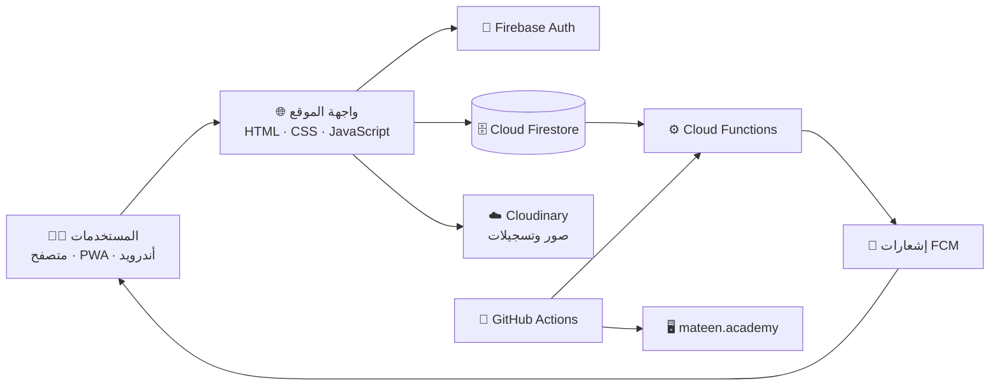

<div align="center">


# برنامج متين العلمي

**منصة تعليمية إسلامية متكاملة لإدارة الطالبات والمواد العلمية**
واجهة عربية RTL كاملة · تطبيق ويب تقدّمي (PWA) · نسخة أندرويد

<br/>

[](https://github.com/Mateenweb/Mateen/actions/workflows/deploy-site.yml)


[**🌐 الموقع**](https://mateen.academy/) &nbsp;·&nbsp; [**📘 دليل الاستخدام**](docs-user-guide.md) &nbsp;·&nbsp; [**📱 تحميل APK**](mateen.apk)

</div>

---

## 📑 المحتويات

[نبذة](#-نبذة) · [المميزات](#-المميزات) · [الأدوار والصلاحيات](#-الأدوار-والصلاحيات) · [المعمارية](#-المعمارية) · [التقنيات](#-التقنيات) · [هيكل المشروع](#-هيكل-المشروع) · [التشغيل المحلي](#-التشغيل-المحلي) · [النشر](#-النشر) · [الأمان](#-الأمان) · [التوثيق](#-التوثيق)

---

## 🌿 نبذة

**برنامج متين العلمي** منصة تجمع في مكان واحد كل ما يحتاجه برنامج علمي: إدارة الطالبات والمعلمات والمشرفات، والمواد والمكتبة والواجبات، والمراسلة والإشعارات، والإحصائيات والشهادات. مبنية بواجهة عربية من اليمين لليسار، وتعمل على الجوال والحاسوب، وتُثبَّت كتطبيق مباشرة من المتصفح.

---

## ✨ المميزات

| | |
|---|---|
| 👥 **إدارة المستخدمين** | 6 أدوار، تسجيل دخول وتسجيل جديد مع مراجعة الحساب قبل التفعيل، وصفحة ترحيب لتهيئة الحساب الجديد |
| 📚 **المواد العلمية** | التفسير والفقه والعقيدة والحديث ومقرأة متين، وكلها تُدار من لوحة التحكم دون تعديل الكود |
| 📖 **المكتبة** | أربعة أقسام: مكتبة متين، والمسار الإثرائي، وبودكاست تبصرة، ودورات متنوعة |
| 📝 **الواجبات** | ربط الواجب بمحاضرة أو مادة، وتسليم ومتابعة وتقييم من المعلمة |
| 💬 **الرسائل والإشعارات** | محادثات مباشرة، وإرسال صور وتسجيلات صوتية، وإشعارات فورية على الجوال |
| 🎓 **إدارة الطالبات** | إضافة فردية وجماعية، وتتبّع المقابلة والقبول، وجدول دراسي بالتاريخ الهجري والميلادي |
| 🏅 **الشهادات التلقائية** | رفع قالب الشهادة وتحديد مواضع الاسم والمادة والتاريخ، ثم إصدار فردي أو جماعي حسب شرط الاستحقاق |
| 📊 **الإحصائيات والتصدير** | الحضور والدرجات وإحصائيات المواد، وتصدير التقارير إلى Excel وWord وPDF |
| 🎨 **ثيمات مخصصة** | 10 ثيمات جاهزة و3 أنماط زخرفية تُطبَّق على كل صفحات الحساب |
| 🛠️ **لوحة الدعم الفني** | إدارة المستخدمين، وأداة فحص شاملة لصفحات الموقع (الأداء وSEO وإمكانية الوصول) |
| 📱 **تطبيق PWA وأندرويد** | قابل للتثبيت من المتصفح، مع نسخة APK جاهزة |

---

## 🔐 الأدوار والصلاحيات

| الخدمة | الإدارة | المشرفة | المعلمة | الطالبة | أصدقاء متين |
|---|:---:|:---:|:---:|:---:|:---:|
| لوحة التحكم | ✅ | ✅ | — | — | — |
| إدارة الطالبات | ✅ | ✅ | — | — | — |
| إضافة محتوى (كل المواد) | ✅ | ✅ | — | — | — |
| إضافة محتوى (مادتها) | ✅ | ✅ | ✅ | — | — |
| مشاهدة المواد | ✅ | ✅ | ✅ | ✅ المسجّل فيها | ✅ |
| المكتبة | ✅ | ✅ | ✅ | ✅ | ✅ |
| الرسائل | ✅ | ✅ | ✅ | ✅ | ✅ |
| الأخبار | ✅ | ✅ | ✅ | ✅ | ✅ |
| تصدير التقارير | ✅ | ✅ | — | — | — |

بالإضافة إلى دور **الدعم الفني** بلوحته الخاصة. التفاصيل الكاملة في [دليل الاستخدام](docs-user-guide.md).

---

## 🏗️ المعمارية



الواجهة ثابتة (HTML/CSS/JS) بدون خطوة بناء، وتتواصل مباشرة مع خدمات Firebase. الوظائف السحابية تتولى الأعمال الخلفية (تنظيف الحسابات المحذوفة وإرسال الإشعارات).

---

## 🧰 التقنيات

| الطبقة | التقنية |
|---|---|
| الواجهة | HTML · CSS · JavaScript (ES Modules) بدون أدوات بناء |
| التصميم | Bootstrap 5 RTL (مستضاف محلياً) · Tabler Icons · خطوط عربية |
| الهوية والبيانات | Firebase Authentication · Cloud Firestore |
| الخلفية | Firebase Cloud Functions |
| الإشعارات | Firebase Cloud Messaging |
| الملفات الوسائطية | Cloudinary |
| PWA | Service Worker · Web App Manifest |
| النشر | GitHub Actions |

---

## 🗂️ هيكل المشروع

<details>
<summary><b>عرض الهيكل</b></summary>

```
Mateen/
├── index.html              # إعادة توجيه لصفحة الدخول
├── manifest.json · sw.js   # إعدادات PWA وService Worker
├── mateen.apk              # نسخة أندرويد
├── docs-user-guide.md      # دليل الاستخدام
├── html/                   # صفحات الموقع (الرئيسية، الدخول، لوحات التحكم، المواد، المكتبة، الرسائل...)
├── css/                    # الأنماط المشتركة وأنماط الصفحات والجوال
├── js/                     # منطق الصفحات (الإدارة، الدعم، المشرفة، المعلمات، الرسائل، الإشعارات...)
├── functions/              # Firebase Cloud Functions
├── libs/                   # Bootstrap RTL وأيقونات Tabler والخطوط
└── .github/workflows/      # النشر التلقائي
```

</details>

---

## 🚀 التشغيل المحلي

لا يحتاج المشروع إلى أدوات بناء. يكفي خادم ملفات ثابتة:

```bash
git clone https://github.com/Mateenweb/Mateen.git
cd Mateen

# تشغيل خادم محلي (اختاري واحداً)
npx serve .
# أو
python -m http.server 8080
```

ثم افتحي `http://localhost:3000` (أو `8080`).

**ربط مشروع Firebase الخاص بك:** استبدلي إعدادات Firebase (الموجودة في الملفات التي تستدعي `initializeApp` داخل مجلد `js/`) بإعدادات مشروعك:

```js
const firebaseConfig = {
  apiKey:            "YOUR_API_KEY",
  authDomain:        "YOUR_PROJECT.firebaseapp.com",
  projectId:         "YOUR_PROJECT",
  storageBucket:     "YOUR_PROJECT.appspot.com",
  messagingSenderId: "YOUR_SENDER_ID",
  appId:             "YOUR_APP_ID"
};
```

> إعدادات Firebase للمتصفح معرّفات عامة بطبيعتها، أما الأسرار الحقيقية فلا تُكتب في الكود أبداً.

---

## 📦 النشر

يتم النشر تلقائياً عبر **GitHub Actions** عند كل دمج في الفرع `main`:

| الوجهة | الآلية |
|---|---|
| **mateen.academy** | `deploy-site.yml` ينشر الموقع ثم يتأكد من عمل الصفحة الرئيسية |
| **GitHub Pages** | تحديث تلقائي للنسخة على `mateenweb.github.io/Mateen` |
| **Cloud Functions** | `deploy-functions.yml` عند تعديل مجلد `functions/` |

بيانات الدخول الخاصة بالنشر محفوظة في **GitHub Secrets** وليست جزءاً من الكود.

**ملاحظات للمطوّرين**
- الملفات على السيرفر تتزامن مع الريبو، فأي ملف غير موجود فيه يُزال عند النشر.
- سطر `<meta charset="utf-8"/>` يجب أن يكون **أول عنصر** داخل `<head>`، ولا يوضع أي محتوى قبل `<!DOCTYPE html>`.

---

## 🛡️ الأمان

- لا توجد أسرار أو كلمات مرور داخل الكود، وبيانات النشر محفوظة في GitHub Secrets.
- الوصول إلى البيانات محكوم بالأدوار وحالة الحساب عبر Firebase Authentication وقواعد Firestore.
- إذا اكتشفتِ ثغرة، يُرجى عدم نشرها علناً والتواصل مع مسؤولة المشروع مباشرة.

---

## 📘 التوثيق

- [دليل الاستخدام لكل دور](docs-user-guide.md): الإدارة والدعم والمشرفة والمعلمة والطالبة.

---

<div align="center">

صُنع بحب لخدمة طالبات العلم 🌿

</div>
